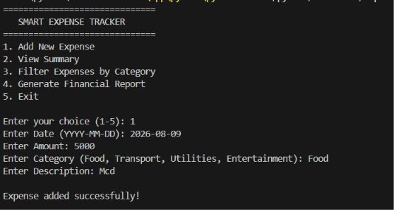
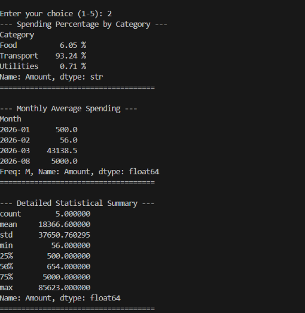
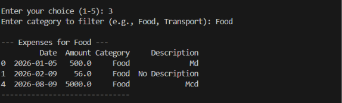
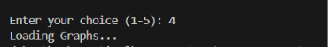

<div align="center">

# 💸 Smart Expense Tracker
### A Python-based personal expense management and visualization project

Track expenses, organize spending by category, review statistics, and visualize financial habits from a console interface.


</div>

---

## 📌 Project Overview

**Smart Expense Tracker** is a command-line Python application for recording and analyzing personal expenses. It stores expense records in `expenses.csv`, validates new entries, summarizes spending, filters records by category, and generates a four-panel financial report.

This project demonstrates practical use of **Python classes, file handling, exception handling, Pandas, NumPy, Matplotlib, and Seaborn**.

> **Screenshot note:** The screenshots below are illustrative examples created to demonstrate the interface and report layout. The displayed sample values are not actual user data.

## ✨ Features

- ➕ Add an expense with date, amount, category, and description.
- ✅ Validate date format, numeric amount, positive values, and supported categories.
- 💾 Save records persistently in `expenses.csv`.
- 📊 View category spending percentages.
- 📅 Calculate average expense transaction amount per month.
- 📈 Display descriptive statistics for the `Amount` column.
- 🔎 Filter expenses by category.
- 📉 Generate four visualizations: category totals, category percentages, daily spending, and amount frequency.
- 🖼️ Save the financial report as `chart.png`.

## 🖥️ Screenshots

### 1. Main Menu

Choose an operation by entering a number from 1 to 5.



### 2. Summary Output

Displays category percentages, monthly average transaction amounts, and descriptive statistics.



### 3. Filter Expenses by Category

Enter a category such as `Food` or `Transport` to view matching records.



### 4. Financial Report

The report combines four charts in one figure. This example uses illustrative sample data.



## 🧰 Technologies Used

| Technology | Purpose |
|---|---|
| Python | Application logic, class, menu, and validation |
| Pandas | DataFrame operations, CSV handling, grouping, filtering, statistics |
| NumPy | Numerical operations, including total expense calculation |
| Matplotlib | Figure layout, plot display, and saving `chart.png` |
| Seaborn | Statistical plots and chart styling |
| `datetime` | Validating dates in `YYYY-MM-DD` format |
| CSV | Persistent storage of expense records |

## 📂 Project Structure

```text
Smart-Expense-Tracker/
├── expense_tracker.py       # Main Python application
├── expenses.csv              # Created/updated when expenses are saved
├── chart.png                 # Generated financial report
├── screenshots/
│   ├── main-menu.png
│   ├── summary-output.png
│   ├── filter-output.png
│   └── financial-report.png
└── README.md
```

Save your Python code as `expense_tracker.py`. The CSV and chart files are created by the program when needed. The screenshots folder contains README examples.

## ⚙️ Installation and Setup

### 1. Install Python

Install Python 3 from [python.org](https://www.python.org/downloads/). On Windows, enable **Add Python to PATH** during installation if the option is shown.

### 2. Clone or download the project

```bash
git clone https://github.com/YOUR-USERNAME/Smart-Expense-Tracker.git
cd Smart-Expense-Tracker
```

Replace `YOUR-USERNAME` and the repository name with your real GitHub details. Alternatively, download the project ZIP and open its folder.

### 3. Install required libraries

```bash
python -m pip install numpy pandas matplotlib seaborn
```

### 4. Run the application

```bash
python expense_tracker.py
```

## 🚀 How to Use

On startup, the application shows this menu:

```text
==============================
   SMART EXPENSE TRACKER
==============================
1. Add New Expense
2. View Summary
3. Filter Expenses by Category
4. Generate Financial Report
5. Exit
```

Enter a choice from `1` to `5`.

### Option 1 — Add New Expense

The program asks for a date, amount, category, and description.

Example:

```text
Enter Date (YYYY-MM-DD): 2026-10-10
Enter Amount: 250
Enter Category (Food, Transport, Utilities, Entertainment): Food
Enter Description: Lunch
```

Validation rules implemented in the code:

- Date must be a valid date matching `YYYY-MM-DD`.
- Amount must be numeric and greater than zero.
- Category must be `Food`, `Transport`, `Utilities`, or `Entertainment`.
- Surrounding spaces are removed from category and description input.
- The category is capitalized before validation.
- A blank description becomes `No Description`.
- A valid record is appended to the DataFrame and saved to `expenses.csv`.

### Option 2 — View Summary

The `get_summary()` method prints three sections.

**A. Spending Percentage by Category**

The code groups expense amounts by category and calculates each category's share of the total:

```python
category_totals = self.data.groupby("Category")["Amount"].sum()
spending_percentage = (category_totals / total_expense) * 100
```

**B. Monthly Average Spending**

The code converts dates to datetime, extracts the month, and calculates the average amount of an individual transaction in each month:

```python
temp_df["Date"] = pd.to_datetime(temp_df["Date"], errors="coerce")
temp_df["Month"] = temp_df["Date"].dt.to_period("M")
monthly_avg = temp_df.groupby("Month")["Amount"].mean()
```

**Important:** This is the **average transaction amount per month**, not the total amount spent during the month.

**C. Detailed Statistical Summary**

```python
self.data["Amount"].describe()
```

Pandas reports count, mean, standard deviation, minimum, quartiles, and maximum.

### Option 3 — Filter Expenses by Category

`filter_expenses(condition)` compares the entered category with the `Category` column and displays matching rows. If the DataFrame is empty or there are no matches, the program displays an appropriate message.

The comparison is an exact match. Use the same capitalization as the saved category, for example `Food`.

### Option 4 — Generate Financial Report

`generate_report()` creates a 2 × 2 figure containing:

| Chart | Purpose |
|---|---|
| Category Totals | Bar chart comparing total spending in each category |
| Spending Percentage | Pie chart showing each category's percentage of total spending |
| Daily Spending | Line chart showing expense totals grouped by date |
| Amount Frequency | Histogram showing the distribution of expense amounts with a KDE curve |

The chart is saved as `chart.png` and displayed using `plt.show()`.

### Option 5 — Exit

Prints a goodbye message and exits the menu loop.

## 🧠 Code Walkthrough

### 1. Imports

```python
import numpy as np
import pandas as pd
import matplotlib.pyplot as plt
import seaborn as sns
import datetime
```

- `numpy` is used for numerical calculations.
- `pandas` manages the expense table and CSV file.
- `matplotlib.pyplot` creates and displays the figure.
- `seaborn` creates styled statistical plots.
- `datetime` validates the date entered by the user.

### 2. `ExpenseTracker` class and `__init__()`

The constructor attempts to load `expenses.csv`. If the file exists, it fills missing values:

| Column | Default for missing values |
|---|---|
| `Amount` | `0.0` |
| `Category` | `Other` |
| `Description` | `No Description` |
| `Date` | `Unknown Date` |

It then saves the cleaned DataFrame back to the CSV file. If the file does not exist, it creates an empty DataFrame with the columns `Date`, `Amount`, `Category`, and `Description`.

### 3. `add_expense(date, amount, category, description)`

This method checks that the amount is positive and the category is supported. If validation passes, it appends a row to `self.data`, saves the CSV, and prints a success message. Invalid values produce an error message.

### 4. `get_summary()`

This method checks for empty data first. Otherwise, it calculates the total amount, category percentages, monthly average transaction amounts, and descriptive statistics.

### 5. `filter_expenses(condition)`

This method filters rows where `Category` equals the requested category. It prints the filtered DataFrame or a message when no records match.

### 6. `generate_report()`

This method checks whether data exists, groups amounts by category and date, and draws the four charts. It adjusts spacing with `plt.tight_layout()`, saves `chart.png`, and displays the figure.

### 7. Main menu and error handling

The `while True` loop repeatedly displays the menu until option `5` is selected. The date is validated with:

```python
datetime.datetime.strptime(date, "%Y-%m-%d")
```

The `try/except ValueError` block handles invalid date formats and non-numeric amounts.

## 📄 CSV Data Format

The CSV contains these columns:

```csv
Date,Amount,Category,Description
2026-10-10,250,Food,Lunch
2026-10-11,120,Transport,Bus fare
2026-10-12,800,Utilities,Electricity bill
```

These rows are examples only. The application writes expense records when a valid expense is added.

## ⚠️ Current Limitations

- Categories are fixed in the code.
- Category filtering requires an exact match.
- Missing amounts become `0.0`, which may affect statistics.
- The monthly average is the mean transaction amount, not the total monthly spend.
- If total spending is zero, percentage calculation needs a zero-total check.
- The program expects the CSV to contain the required columns; malformed CSV files are not fully handled.
- There is no login system, database, budget alert, or edit/delete feature.

## 🔮 Future Improvements

- Add custom categories and case-insensitive filtering.
- Add monthly budgets and overspending alerts.
- Add edit and delete functionality.
- Use SQLite for storage.
- Build a graphical interface with Streamlit or Tkinter.
- Add unit tests and stronger CSV validation.
- Add export options for reports and summaries.

## 🎯 Learning Outcomes

This project helps practice:

- Object-oriented programming and methods
- CSV file handling
- Input validation and exception handling
- Missing-value handling and data cleaning
- Pandas grouping, aggregation, and filtering
- Numerical calculations with NumPy
- Data visualization with Matplotlib and Seaborn


## 📜 License

For a public repository, add a `LICENSE` file to specify how others may use, modify, and distribute this project.

---

<div align="center">

**Made with Python 🐍 | Track smarter, spend wiser.**

</div>
