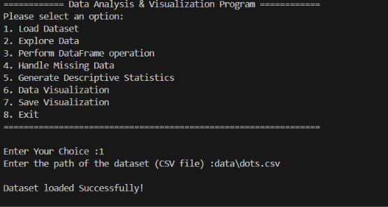
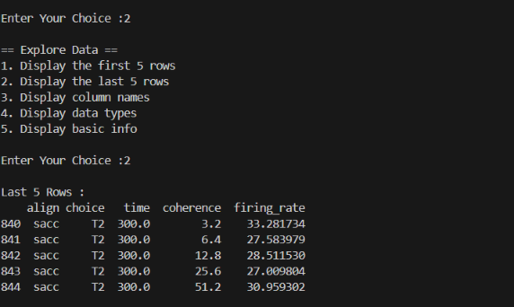
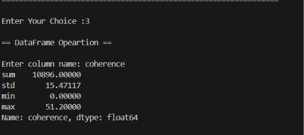
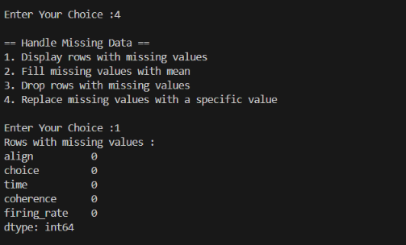
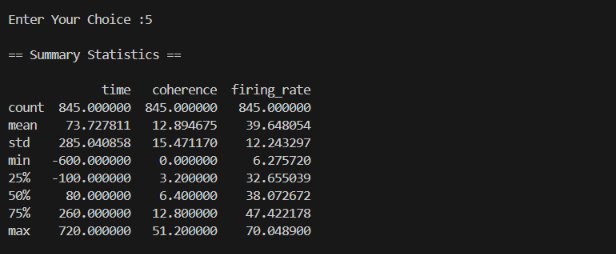
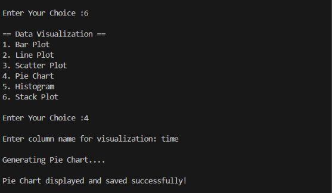

<div align="center">

# 📊 Sale Data Analyzer

### A Python-Based Data Analysis & Visualization Tool

**Load · Explore · Clean · Analyze · Visualize · Save**

<p>
  
  
  
  
</p>

*A menu-driven Python application for analyzing CSV datasets, handling missing values, generating descriptive statistics, and creating visual charts.*

</div>

---

## 📌 Table of Contents

- [✨ Overview](#-overview)
- [🎯 Project Objectives](#-project-objectives)
- [🚀 Features](#-features)
- [🧰 Technologies Used](#-technologies-used)
- [📁 Project Structure](#-project-structure)
- [⚙️ Installation](#️-installation)
- [▶️ How to Run](#️-how-to-run)
- [🧭 Application Menu](#-application-menu)
- [📂 Feature Guide](#-feature-guide)
  - [1. Load Dataset](#1-load-dataset)
  - [2. Explore Data](#2-explore-data)
  - [3. DataFrame Operations](#3-dataframe-operations)
  - [4. Handle Missing Data](#4-handle-missing-data)
  - [5. Descriptive Statistics](#5-descriptive-statistics)
  - [6. Data Visualization](#6-data-visualization)
  - [7. Save Visualization](#7-save-visualization)
- [📊 Supported Charts](#-supported-charts)
- [🖼️ Screenshots](#️-screenshots)
- [🧪 Sample Dataset](#-sample-dataset)
- [🛡️ Error Handling](#️-error-handling)
- [🧠 Python Concepts Used](#-python-concepts-used)
- [🔮 Future Improvements](#-future-improvements)
- [👨‍💻 Author](#-author)
- [📄 License](#-license)

---

## ✨ Overview

**Sale Data Analyzer** is a console-based Python project designed to make basic data analysis easier. It allows users to load a CSV dataset, inspect its structure, perform calculations on selected columns, manage missing values, view summary statistics, and generate different types of charts.

The application uses a class-based design with `SaleDataAnalyzer`, keeping the main data-analysis operations organized into separate methods.

> **Note:** This project is a general CSV data analyzer. Although its name includes “Sale”, the code can work with many types of tabular datasets, provided the selected columns are suitable for the requested operation or chart.

## 🎯 Project Objectives

- Read and analyze CSV files using Pandas.
- Understand dataset rows, columns, data types, and basic information.
- Perform common statistical operations on a selected column.
- Identify and handle missing values.
- Generate descriptive statistics.
- Visualize data using six chart options.
- Save a generated chart as an image file.
- Practice Python OOP and data-analysis libraries in one project.

## 🚀 Features

<table>
<thead>
<tr>
<th>Feature</th>
<th>Description</th>
</tr>
</thead>
<tbody>
<tr><td>📥 Dataset Loading</td><td>Load a CSV file using a user-provided file path.</td></tr>
<tr><td>🔍 Data Exploration</td><td>View the first and last five rows, column names, data types, and basic information.</td></tr>
<tr><td>🧮 DataFrame Operations</td><td>Calculate sum, standard deviation, minimum, and maximum for a selected column.</td></tr>
<tr><td>🧹 Missing-Value Handling</td><td>Inspect missing values, fill numeric nulls with their mean, drop incomplete rows, or fill numeric nulls with a specified integer.</td></tr>
<tr><td>📈 Descriptive Statistics</td><td>Generate summary statistics with Pandas `describe()`.</td></tr>
<tr><td>📊 Data Visualization</td><td>Create bar, line, scatter, pie, histogram, and stack plots.</td></tr>
<tr><td>💾 Save Charts</td><td>Save the most recently generated figure using a filename supplied by the user.</td></tr>
<tr><td>🛡️ Basic Error Handling</td><td>Handle missing files, invalid menu input, invalid columns, and attempts to use features before loading a dataset.</td></tr>
</tbody>
</table>

## 🧰 Technologies Used

<div align="center">

| Technology | Purpose |
|---|---|
| **Python 3** | Main programming language |
| **Pandas** | CSV loading, DataFrame operations, missing-value handling, and statistics |
| **Matplotlib** | Chart creation, labels, titles, displaying, and saving figures |
| **Seaborn** | Bar, line, scatter, and histogram visualizations |

</div>

## 📁 Project Structure

The following is a suggested structure for the project based on the supplied code. Adjust names and folders to match your actual repository.

```text
Sale-Data-Analyzer/
│
├── SaleDataAnalyzer.py       # Main Python application
├── README.md                 # Project documentation
├── requirements.txt          # Python library dependencies
│
├── dataset/
│   └── sales.csv             # Example CSV dataset (optional)
│
└── screenshots/
    ├── main-menu.png
    ├── dataset-loaded.png
    ├── explore-data.png
    ├── missing-values.png
    ├── summary-statistics.png
    ├── bar-plot.png
    └── saved-chart.png
```

**Important:** `SaleDataAnalyzer.py`, `dataset/sales.csv`, and the screenshot filenames above are suggested names, not confirmed files from your current folder. Use the filenames and structure that actually exist in your project.

## ⚙️ Installation

### 1. Install Python

Install Python 3 from the official website:

[Download Python](https://www.python.org/downloads/)

During installation on Windows, enable **Add Python to PATH** if that option is shown.

### 2. Clone the repository

Replace `YOUR-USERNAME` and `YOUR-REPOSITORY` with your GitHub username and repository name.

```bash
git clone https://github.com/YOUR-USERNAME/YOUR-REPOSITORY.git
```

Move into the project folder:

```bash
cd Sale-Data-Analyzer
```

If your repository uses a different folder name, use that folder name instead.

### 3. Install required libraries

Create a `requirements.txt` file containing:

```text
pandas
matplotlib
seaborn
```

Then run:

```bash
python -m pip install -r requirements.txt
```

Alternatively, install the libraries directly:

```bash
python -m pip install pandas matplotlib seaborn
```

### 4. Verify the installation

```bash
python -c "import pandas, matplotlib, seaborn; print('All libraries installed successfully!')"
```

## ▶️ How to Run

Open a terminal in the project directory and run the main Python file.

```bash
python SaleDataAnalyzer.py
```

If your Python file has a different name, replace `SaleDataAnalyzer.py` with the correct filename.

When the program starts, the main menu appears. Select an option by entering its corresponding number.

## 🧭 Application Menu

The program provides the following menu:

```text
============ Data Analysis & Visualization Program ============

Please select an option:

1. Load Dataset
2. Explore Data
3. Perform DataFrame operation
4. Handle Missing Data
5. Generate Descriptive Statistics
6. Data Visualization
7. Save Visualization
8. Exit
===============================================================
Enter Your Choice:
```

### Recommended workflow

```text
Start Program
     |
     v
Load Dataset (Option 1)
     |
     v
Explore Data (Option 2)
     |
     v
Perform Operations / Clean Data
     |
     v
Generate Statistics
     |
     v
Create a Visualization
     |
     v
Save the Chart (Optional)
     |
     v
Exit Program
```

## 📂 Feature Guide

### 1. Load Dataset

**Menu option:** `1. Load Dataset`

The program asks for the path of a CSV file and reads it using `pandas.read_csv()`.

Example:

```text
Enter the path of the dataset (CSV file): dataset/sales.csv

Dataset loaded Successfully!
```

**What it does**
- Requests a dataset path from the user.
- Loads the CSV into a Pandas DataFrame.
- Stores the DataFrame in `self.df`.
- Displays an error message if the file is not found.

**Example file paths**

Windows:

```text
C:\Users\YourName\Documents\sales.csv
```

Relative path:

```text
dataset/sales.csv
```

Use a path that exists on your computer.

### 2. Explore Data

**Menu option:** `2. Explore Data`

This feature offers five exploration choices.

| Choice | Operation | Code used |
|---|---|---|
| 1 | Display first five rows | `self.df.head()` |
| 2 | Display last five rows | `self.df.tail()` |
| 3 | Display column names | `list(self.df.columns)` |
| 4 | Display data types | `self.df.dtypes` |
| 5 | Display basic information | `self.df.info()` |

Example:

```text
== Explore Data ==

1. Display the first 5 rows
2. Display the last 5 rows
3. Display column names
4. Display data types
5. Display basic info

Enter Your Choice:
```

This helps users understand the dataset before performing calculations or creating charts.

### 3. DataFrame Operations

**Menu option:** `3. Perform DataFrame operation`

Enter the name of the column you want to analyze. The program uses Pandas aggregation to display:

```python
self.df[col].agg(['sum', 'std', 'min', 'max'])
```

| Operation | Meaning |
|---|---|
| `sum` | Calculates the total |
| `std` | Calculates standard deviation |
| `min` | Finds the minimum value |
| `max` | Finds the maximum value |

Example:

```text
Enter column name: Sales

sum    ...
std    ...
min    ...
max    ...
```

The actual values depend on the dataset. If the column name is invalid, the program displays an error message.

**Tip:** These operations are most useful with numeric columns. Some operations may not be meaningful or supported for non-numeric data.

### 4. Handle Missing Data

**Menu option:** `4. Handle Missing Data`

The application provides four choices for handling missing values.

#### Option 1 — Display missing-value counts

The current code prints the count of missing values in each column:

```python
self.df.isnull().sum()
```

This is a count per column, not a display of the actual rows containing missing values, despite the menu wording.

#### Option 2 — Fill missing values with mean

For columns identified as numeric (`int64` or `float64`), the code fills missing values with that column's mean.

```python
self.df[col] = self.df[col].fillna(self.df[col].mean())
```

If there are no missing values, a message is displayed.

#### Option 3 — Drop rows with missing values

The code removes rows containing one or more missing values:

```python
self.df.dropna(inplace=True)
```

**Warning:** This changes the current DataFrame in memory. Rows removed this way are not automatically restored.

#### Option 4 — Replace missing values with a specific value

The program asks for an integer and uses it to fill missing values in numeric columns.

```python
self.df[col] = self.df[col].fillna(
    int(input("\nEnter Specific Value :"))
)
```

**Current implementation notes**
- Mean filling and specific-value filling target numeric columns with `int64` or `float64` dtypes.
- Missing values in text columns are not filled by these two options.
- The specific replacement value must be a valid integer.
- The program does not currently save cleaned data to a new CSV file.

### 5. Descriptive Statistics

**Menu option:** `5. Generate Descriptive Statistics`

The program runs:

```python
self.df.describe()
```

For numeric columns, Pandas normally reports statistics such as:

| Statistic | Meaning |
|---|---|
| `count` | Number of non-missing values |
| `mean` | Average |
| `std` | Standard deviation |
| `min` | Minimum |
| `25%` | First quartile |
| `50%` | Median |
| `75%` | Third quartile |
| `max` | Maximum |

The output depends on the dataset's column types and Pandas behavior.

### 6. Data Visualization

**Menu option:** `6. Data Visualization`

The application offers six chart types. Depending on the selected chart, the user enters one column or an x-axis and y-axis column.

```text
== Data Visualization ==

1. Bar Plot
2. Line Plot
3. Scatter Plot
4. Pie Chart
5. Histogram
6. Stack Plot
```

For Bar, Line, Scatter, and Stack plots, the code asks for x-axis and y-axis column names. For Pie charts and Histograms, it asks for one column name.

#### Bar Plot

Uses Seaborn's `barplot()` to visualize a relationship between the selected x and y columns.

```python
sns.barplot(x=x_axis, y=y_axis, data=self.df)
```

Useful for comparing an aggregated numeric value across categories.

#### Line Plot

Uses Seaborn's `lineplot()`.

```python
sns.lineplot(x=x_axis, y=y_axis, data=self.df)
```

Useful for showing trends, especially when the x-axis represents time or an ordered value.

#### Scatter Plot

Uses Seaborn's `scatterplot()`.

```python
sns.scatterplot(x=x_axis, y=y_axis, data=self.df)
```

Useful for inspecting the relationship between two numeric variables.

#### Pie Chart

Counts the frequency of values in the selected column and displays the proportions.

```python
data_counts = self.df[column].value_counts()
plt.pie(
    data_counts,
    labels=data_counts.index,
    autopct='%1.1f%%'
)
```

Useful for showing the distribution of categories. A column with many unique values can make the chart difficult to read.

#### Histogram

Uses Seaborn's `histplot()` with a KDE curve enabled.

```python
sns.histplot(self.df[column], kde=True)
```

Useful for examining the distribution of a numeric column.

#### Stack Plot

Uses Matplotlib's `stackplot()` with the selected x and y columns.

```python
plt.stackplot(self.df[x_axis], self.df[y_axis])
```

Useful for visualizing stacked areas. For meaningful results, the x-axis should generally be ordered and the y-values should be suitable numeric data.

#### Chart labels and titles

The code sets x-axis labels, y-axis labels where applicable, and chart titles using the selected column names. After creating a plot, it stores the current figure in `self.figure`, displays the plot, and closes the Matplotlib plotting state.

### 7. Save Visualization

**Menu option:** `7. Save Visualization`

After generating a chart, select the save option and enter a filename.

```text
== Save Visualization ==

Enter file name to save the plot (e.g., linechart.png):
```

The application calls:

```python
self.figure.savefig(name)
```

Example filename:

```text
sales_bar_chart.png
```

The chart is saved to the current working directory unless a different path is entered.

**Important:** Generate a visualization before choosing this option. The program displays an error if `self.figure` is `None`.

The current code saves the most recently stored figure. It does not automatically create a dedicated output folder or export the chart in a specific resolution.

## 📊 Supported Charts

| Chart | Input | Library | Typical use |
|---|---|---|---|
| Bar Plot | X and Y columns | Seaborn | Compare categories |
| Line Plot | X and Y columns | Seaborn | Display trends |
| Scatter Plot | X and Y columns | Seaborn | Explore relationships |
| Pie Chart | One column | Matplotlib | Show category proportions |
| Histogram | One column | Seaborn | Inspect numeric distribution |
| Stack Plot | X and Y columns | Matplotlib | Show stacked area values |

## 🖼️ Screenshots

Add screenshots of your actual running application to the `screenshots/` folder, then update the filenames below to match your files. The image names in this section are placeholders; they are not included automatically by this README.

### Main Menu



### Dataset Loaded



### Explore Data



### Missing-Value Handling



### Summary Statistics



### Data Visualization


### Saved Chart



> **How to add screenshots:** Run the program, capture the terminal or chart using Snipping Tool (`Win + Shift + S` on Windows), and save each image in the `screenshots/` folder using the exact filenames above. If a screenshot is not present, its image will not display on GitHub.

## 🧪 Sample Dataset

You can use a CSV file with columns appropriate for your intended analysis. For example, a small sales dataset could contain:

```csv
Date,Product,Category,Quantity,Sales,Profit
2026-01-01,Notebook,Stationery,10,500,100
2026-01-02,Pen,Stationery,20,200,60
2026-01-03,Mouse,Electronics,5,1500,250
2026-01-04,Keyboard,Electronics,3,1800,300
2026-01-05,Bottle,Accessories,8,800,120
```

Save it as `sales.csv` and enter its path when prompted. This is an illustrative dataset for trying the application, not a dataset included in the supplied code.

**Suggested columns to try**
- `Sales` or `Profit` for numeric calculations and histograms.
- `Category` for a pie chart.
- `Date` and `Sales` for a line chart, after ensuring the date column is interpreted appropriately.
- `Quantity` and `Sales` for a scatter plot.

## 🛡️ Error Handling

The supplied code includes basic handling for several common situations.

| Situation | Current behavior |
|---|---|
| CSV file not found | Displays an invalid-file message |
| Dataset not loaded | Displays a message before exploration, operations, cleaning, statistics, or visualization |
| Invalid menu input | Catches `ValueError` when integer conversion fails |
| Invalid column name | Displays a column-name error in DataFrame operations and visualization |
| Invalid submenu choice | Displays an appropriate selection message |
| Save before generating a chart | Displays a message and returns from `save_chart()` |

**Known limitations in the current code**
- `load_data()` catches `FileNotFoundError`, but not every possible CSV parsing or permission error.
- `save_chart()` catches `ValueError`; other filesystem errors may still occur.
- In `explore_data()`, `print(self.df.info())` also prints the return value (`None`) after `info()` output.
- In missing-data option 1, the output is per-column counts rather than the actual rows with missing values.
- The stack plot may need additional handling for categorical or unsorted x-axis values.
- The destructor `__del__()` currently contains only `pass` and performs no cleanup.

## 🧠 Python Concepts Used

This project provides practice with:

- **Object-Oriented Programming (OOP):** `SaleDataAnalyzer` class and instance methods.
- **Constructor:** `__init__()` initializes the DataFrame, file path, and figure attributes.
- **Instance attributes:** `self.df`, `self.path`, and `self.figure`.
- **Conditional statements:** `if`, `elif`, and `else`.
- **Loops:** `while True` keeps the main menu running until exit.
- **Exception handling:** `try` and `except`.
- **User input:** `input()` for menu selections, file paths, and column names.
- **Pandas DataFrames:** Loading, inspecting, aggregating, cleaning, and summarizing tabular data.
- **Data visualization:** Creating plots with Matplotlib and Seaborn.
- **File output:** Saving a chart using `savefig()`.

## 🔮 Future Improvements

Possible improvements for a future version:

- [ ] Add a graphical user interface using Tkinter or Streamlit.
- [ ] Add a menu option to export the cleaned dataset to CSV.
- [ ] Display the actual rows containing missing values.
- [ ] Support filling missing values in text columns.
- [ ] Add more flexible missing-value strategies, such as median and mode.
- [ ] Improve validation for numeric and categorical chart inputs.
- [ ] Handle CSV parsing errors, permission errors, and invalid output paths.
- [ ] Let users choose an output folder and chart resolution.
- [ ] Add more chart types, such as box plots, heatmaps, and count plots.
- [ ] Add automated tests for core methods.
- [ ] Add a sample dataset and real screenshots to the repository.
- [ ] Add a `requirements.txt` file with pinned dependency versions.

## 👨‍💻 Author

**Avinash Vaghasiya**

*Diploma in Computer Engineering Graduate | AI & ML with Data Science Student*

Interested in Python, Data Science, Machine Learning, and AI.

## 📄 License

This project can be shared under an open-source license such as the MIT License. If you choose MIT, add a `LICENSE` file containing the appropriate license text and update this section accordingly.

---

<div align="center">

**If you find this project useful, consider giving the repository a ⭐ on GitHub!**

*Built with Python, Pandas, Matplotlib, and Seaborn.*

</div>
